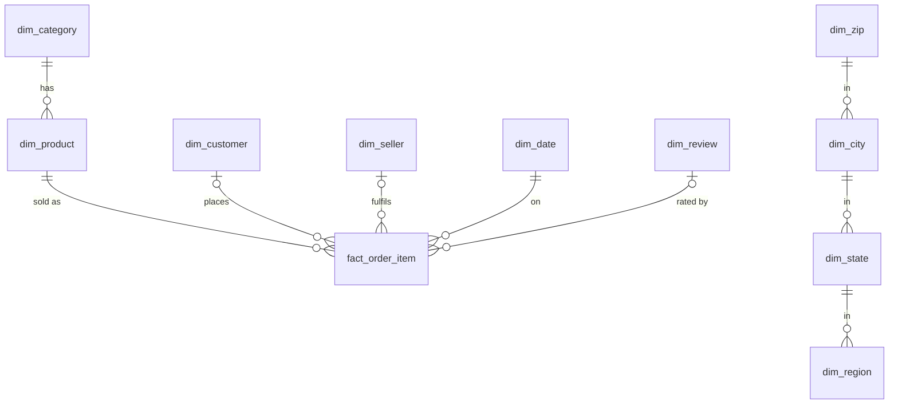

# Assignment 2 — Part 1: Dimensional Modeling of the E-Commerce Dataset

**Course:** M26 — Data Analytics I · **Part:** 1 (Data Warehouse & OLAP)

---

## 1. Overview

Part 1 designs and builds a **star-schema data warehouse** for the Brazilian
e-commerce dataset (orders, customers, sellers, products, payments, reviews),
loads it through a repeatable **staging → dimensions → facts** ETL pipeline,
and answers **10 analytical questions** with SQL over the warehouse.

**Deliverables produced**

| Deliverable | Location |
|---|---|
| ER diagram (Crow's Foot notation) | `part1/diagrams/er_diagram.mmd`, `er_diagram_crowsfoot.png`, `er_diagram_crowsfoot.svg` |
| DDL (star schema) | `part1/sql/01_create_schema.sql` |
| Staging loads | `part1/sql/02_load_staging.sql` |
| Dimension loads | `part1/sql/03_load_dimensions.sql` |
| Fact loads | `part1/sql/04_load_facts.sql` |
| Analytical views | `part1/sql/05_create_views.sql` |
| Validation checks (22) | `part1/sql/06_validate.sql` |
| Analytical queries Q1–Q10 | `part1/sql/queries/q01…q10_*.sql` |
| ETL driver scripts | `part1/etl/run_etl.py`, `run_queries.py`, `common.py` |
| Seed data (state→region mapping) | `part1/seed/br_state_region.csv` |
| Built warehouse (DuckDB file) | `part1/olist_dw.duckdb` |
| ETL run log + report | `part1/outputs/etl_log.txt`, `part1/outputs/etl_report.md` |
| Query result CSVs (28 result sets) | `part1/outputs/csv/q01…q10_*.csv` |
| Query results (formatted) | `part1/outputs/query_results.md` |

Everything is reproducible with `python part1/etl/run_etl.py` followed by
`python part1/etl/run_queries.py` (DuckDB).

---

## 2. Grain & Schema Design

### 2.1 Fact grain

The warehouse has **two fact tables** at different grains:

- **`fact_order_item`** — *one row per order line item*
  (grain key: `order_id + order_item_id`, 112,650 rows). This is the primary
  fact table: every analytical question about revenue, products, sellers,
  geography and time is answered from it.
- **`fact_order_payment`** — *one row per order payment*
  (grain key: `order_id + payment_sequential`, 103,886 rows), kept separate
  because payments are at the order level, not the item level (avoiding a
  many-to-many fan-out if merged into `fact_order_item`).

### 2.2 Star schema (16 dimensions + 2 facts)

```
                         dim_date (2,193)
                              │
dim_review (98,674) ──┐       │        dim_product (32,952)
                      │       │              │
                      ▼       ▼              ▼
        fact_order_item ═══ dim_category (74)
                      ▲       ▲
                      │       │
dim_customer (99,442) ┘       └── dim_seller (3,096) ── dim_seller_acquisition (843)
                              │
                    dim_zip (19,178) ── dim_city (6,246) ── dim_state (28) ── dim_region (6)

        fact_order_payment ── dim_payment_type (6)   (+ order/date keys)
        conformed: dim_order_status (9), dim_delivery_status (4), dim_delivery_bucket (6)
```

Design decisions:

- **Geography is snowflaked** (`zip → city → state → region`) because the
  hierarchy is strict and heavily shared; this keeps Q5's roll-up clean and
  avoids 4 denormalised text columns on every zip.
- **Date is a full dimension** (`dim_date`, daily grain, 2016-01-01 →
  2021-12-31) with `year`, `quarter`, `month`, `month_name`, `day_of_week`,
  `is_weekend` — enabling the roll-ups in Q1/Q2 without date functions.
- **Unknown members (`key = -1`)** are used for missing foreign keys:
  2,454 items whose order was never delivered (`delivered_date_key = -1`)
  and 749 orders without a review (`review_key = -1`) are **kept** in the
  fact table rather than dropped (checks 7–8).
- **Degenerate dimension**: `order_id` is stored on
  `fact_order_item` as a degenerate dimension (no order dimension, since the
  order itself has no attributes beyond status/dates that are already modelled).
- **Late-arriving/one-off dimensions**: `dim_review` is one-per-order
  (98,673 unique orders, check 22) and is referenced from the fact grain.

### 2.3 ER diagram (Crow's Foot)

The ER diagram is drawn in **Crow's Foot notation** (source:
`part1/diagrams/er_diagram.mmd`, rendered with Mermaid to
`er_diagram_crowsfoot.png` / `.svg`):

- `||--o{` = exactly one to zero-or-many (e.g. one *category* has many
  *products*),
- `|o--o{` = zero-or-one to zero-or-many (e.g. an *order item* has zero-or-one
  *review*),
- `}o--||` many-to-one FK edges from facts to dimensions,
- primary keys are underlined, foreign keys marked `(FK)`.

The full diagram covers all 18 tables; an excerpt:



---

## 3. ETL Pipeline

Pipeline (all SQL, driven by `part1/etl/run_etl.py` against DuckDB):

1. **`02_load_staging.sql`** — raw CSVs loaded 1:1 into `stg_*` tables
   (no transformation, full traceability).
2. **`03_load_dimensions.sql`** — dimensions built with `SELECT DISTINCT` +
   `ROW_NUMBER()` surrogate keys; conformed date dimension generated
   calendarically; geography snowflake built bottom-up
   (region → state → city → zip) with **Unknown fallback members** at each
   level; seller acquisition funnel derived from `seller_lead_type` /
   `lead_origin` (843 rows).
3. **`04_load_facts.sql`** — facts joined to dimension surrogate keys;
   revenue = `price + freight_value`; missing delivery dates / reviews map to
   `-1` unknown members; **no line item is ever dropped** (checks 16–18).
4. **`05_create_views.sql`** — convenience analytical views.
5. **`06_validate.sql`** — 22 automated validation checks.

### 3.1 Validation results — 22 / 22 PASS

Highlights (full table in `part1/outputs/etl_report.md`):

| Check | Result |
|---|---|
| `fact_order_item` rows == `order_items.csv` rows | 112,650 = 112,650 ✅ |
| `fact_order_payment` rows == `order_payments.csv` rows | 103,886 = 103,886 ✅ |
| Fact grain unique on `(order_id, order_item_id)` | ✅ |
| `SUM(revenue)` == `SUM(price + freight)` in staging (2 dp) | 15,843,553.24 ✅ |
| `SUM(payment_value)` == staging total (2 dp) | 16,008,872.12 ✅ |
| Orphan FKs (zip→city, city→state, state→region, product→category, seller→acquisition, fact→customer/seller/product/date) | all 0 ✅ |
| Unknown-member fallbacks actually used (zip/city) | 0 needed ✅ |
| Customer dimension unique on `customer_id` | 99,442 ✅ |
| Review dimension unique per order | 98,673 ✅ |

### 3.2 Loaded volumes

| Table | Rows | | Table | Rows |
|---|---|---|---|---|
| fact_order_item | **112,650** | | dim_customer | 99,442 |
| fact_order_payment | **103,886** | | dim_review | 98,674 |
| dim_zip | 19,178 | | dim_product | 32,952 |
| dim_city | 6,246 | | dim_seller | 3,096 |
| dim_date | 2,193 | | dim_seller_acquisition | 843 |
| dim_state | 28 | | dim_category | 74 |
| dim_region | 6 | | others (status/delivery/payment) | 9 / 4 / 6 / 6 |

---

## 4. Analytical Queries — Q1–Q10

All 10 questions are answered in `part1/sql/queries/q01…q10_*.sql`; results
are exported to `part1/outputs/csv/` (28 result sets) and formatted in
`part1/outputs/query_results.md`. Key findings:

### Q1 — Revenue by time (roll-up: day → month → quarter → year → total)
- Total revenue **R$ 15,843,553.24** across **98,666 orders**.
- Growth is steep: **2016 R$ 57,183** (312 orders, partial year) →
  **2017 R$ 7.14 M** (44,579 orders) → **2018 R$ 8.64 M** (53,775 orders).

### Q2 — Peak month per year
- 2016 → **October** (R$ 56,808.84); 2017 → **November** (R$ 1,179,143.77,
  the Black-Friday month); 2018 → **April** (R$ 1,159,698.04).

### Q3 — Revenue by product category (top-N with cumulative %)
- Top 3 categories: **health_beauty R$ 1.44 M (9.1%)**, **watches_gifts
  R$ 1.31 M (8.2%)**, **bed_bath_table R$ 1.24 M (7.8%)**; the top 7
  categories already account for ~50% of revenue.

### Q4 — Drill-down: category → product
- Within health_beauty the #1 product (`bb50f2e2…`) earns R$ 67,606 — only
  **4.7%** of its category, i.e. revenue is spread across many products
  (2,444 distinct SKUs in that category alone).

### Q5 — Geography roll-up (region → state → city)
- **Southeast = 64.6%** of all revenue; **São Paulo state alone = 37.4%**;
  the city of **são paulo = 13.7%** (R$ 2.17 M) — a strongly
  geography-concentrated business.

### Q6 — Top customers
- The single biggest customer (rio de janeiro, RJ) spent **R$ 13,664.08**
  in one 8-item order; the top-10 list is dominated by Southeast customers.

### Q7 — Top seller per state
- In **BA (Bahia)** one seller (`53243585…`, lauro de freitas) generates
  **76.9%** of the state's revenue — extreme seller concentration outside
  the Southeast; in SP the top seller is only 2.5% (1,816 sellers compete).

### Q8 — Cube: region × category × year
- A `GROUP BY CUBE` over (region, category, year) produces **8 grouping
  sets** (grouping IDs 0–7) and **718 base cells**; every slice re-sums to
  the same grand total R$ 15,843,553.24 — demonstrating the additivity of
  revenue across all dimensions (fully additive measure).

### Q9 — Review score vs delivery performance
The strongest relationship in the dataset:

| Delivery | Orders | Avg review | % negative (1–2) | % positive (4–5) | Avg delay (days) |
|---|---|---|---|---|---|
| Early (> 7 days) | 71,308 | **4.32** | 9.0% | 83.5% | −15.9 |
| On time | 1,292 | 4.03 | 12.4% | 73.7% | 0.0 |
| Late (1–7 days) | 3,672 | 2.72 | 49.4% | 38.3% | +3.6 |
| Late (> 7 days) | 2,863 | **1.70** | **79.3%** | 11.7% | +19.6 |
| Not delivered | 2,190 | 1.76 | 77.5% | 14.7% | — |

→ Reviews collapse from 4.3 to 1.7 as delivery slips; **late delivery is the
primary driver of negative reviews**.

### Q10 — Seller-acquisition funnel vs revenue
- **Organic** sellers: 144 sellers → R$ 263,506 (34.0% of funnel revenue,
  R$ 1,830/seller); **Other/Unknown**: R$ 248,928 (32.1%, but the highest
  yield at R$ 2,861/seller); **Paid media**: 103 sellers → R$ 183,208
  (23.6%, R$ 1,779/seller). Organic + unknown channels out-earn paid media.

---

## 5. Reproducibility

```powershell
# from the assignment root
python part1/etl/run_etl.py       # staging -> dimensions -> facts + 22 checks
python part1/etl/run_queries.py   # Q1-Q10 -> CSV exports + formatted results
```

Requires: DuckDB (Python package) and the raw CSVs in `M26_DA_A2/`.
The scripts are idempotent — they drop and rebuild the warehouse each run.
